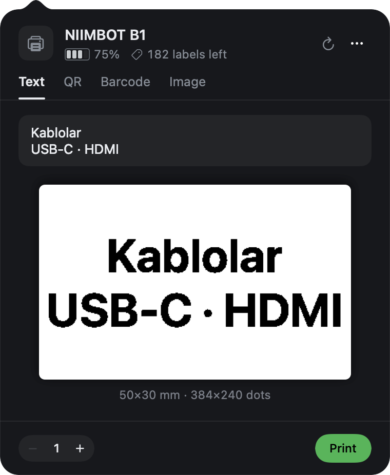
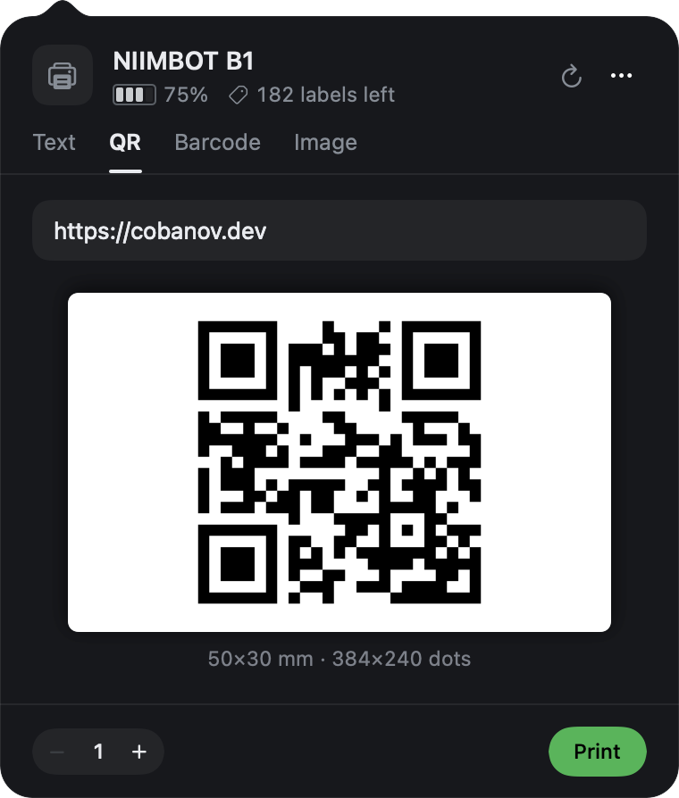

<h1 align="center">NiimBar</h1>

<p align="center">
  The NIIMBOT B1 label printer in the macOS menu bar.
</p>

<p align="center">
  
  
</p>

<p align="center">
  
  &nbsp;
  
</p>

NIIMBOT has no Mac app. NiimBar is a small one: click the printer in the menu bar, type a
label, see exactly what will print, print it.

- **Status at a glance:** battery, lid, roll and labels left, read from the printer. The menu bar
  icon turns into a warning when the lid is open, the roll is out or the battery is low, and a
  notification says when the battery runs low.
- **Text, QR, barcode or image:** text sizes itself to fill the label; QR and Code 128 are drawn
  on whole dots so they scan; images come from the clipboard, a file or a drop.
- **What you see is what burns:** the preview is the 1-bit bitmap sent to the head, dot for dot.
- **No driver, no account:** it talks to the printer over USB.

## Install

Requires macOS 14 and Swift 6 (Xcode or the command line tools).

```sh
git clone https://github.com/cobanov/niimbar.git
cd niimbar
make install   # builds, bundles and launches /Applications/NiimBar.app
```

Connect the B1 with a USB-C **data** cable; it shows up as `/dev/cu.usbmodemB1_*`.

## Use

| | |
|---|---|
| `⌘P` | Print |
| `⌘R` | Refresh the printer's status |
| `⇧⌘V` | Paste an image or text |
| `…` | Label size, density, launch at login, quit |

The B1 does not report its label size, so pick it once from `…` (50×30 mm by default). The head is
48 mm wide; on wider labels the outer millimetre on each side stays blank, and the preview shows it.

NiimBar opens the port only while it talks to the printer, so [NiimBlue](https://niim.blue) and
other tools can use the printer when NiimBar is idle.

## How it works

The B1's USB serial protocol, as implemented by
[niimbluelib](https://github.com/MultiMote/niimbluelib) (the library behind NiimBlue), is written
down in [docs/b1-protocol.md](docs/b1-protocol.md). NiimBar's encoder reproduces its frames byte
for byte; `make test` checks them.

```
Sources/NiimBar/
  SerialPort.swift     115200 8N1, opened per request
  Niimbot.swift        packets, status, RFID, the print sequence and row encoder
  LabelRenderer.swift  text / QR / barcode / image -> 1-bit label bitmap
  PanelView.swift      the panel
  StatusPanel.swift    the menu bar panel with the arrow, shared with GHBar
```

Only the B1 is supported. Other NIIMBOT models use the same packets but different print
sequences and head widths.

## License

MIT
